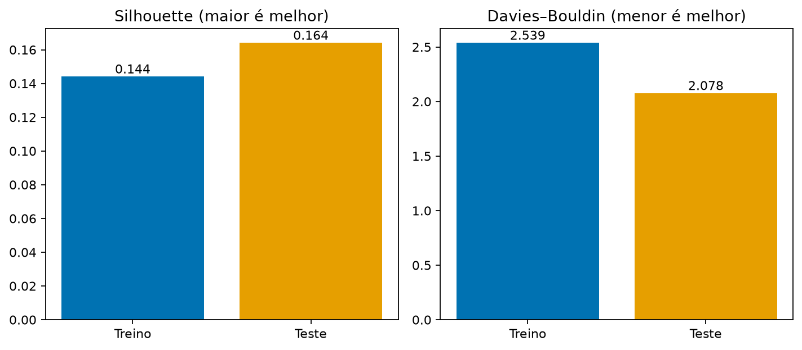

# Água na Rua — IA & Machine Learning

Global Solution CitizenTech · Engenharia de Software · **3ESPZ** · FIAP 2026.2

**[Abrir no Colab](https://colab.research.google.com/github/vbastelli/GS-2-IA-ML/blob/main/ml/agua_na_rua_colab.ipynb)** · **[Baixar notebook para Colab](ml/agua_na_rua_colab.ipynb?raw=1)** · [Relatório](RELATORIO_ML.md) · [Requisitos e evidências](docs/GUIA_AVALIACAO.md) · [Todos os resultados](ml/resultados/README.md)

<details>
<summary><strong>Ficha da CitizenTech — texto integral da proposta comum às disciplinas</strong></summary>

# Ficha da CitizenTech — Água na Rua

- **Nome:** Água na Rua.
- **Cidade e bairro:** São Paulo — Jardim Peri, com seleção de ruas e pontos específicos após validação com moradores.
- **Cidadão beneficiado:** moradores que precisarão circular por trechos sujeitos a alagamento, especialmente ao sair ou retornar do trabalho.
- **Problema em uma frase:** quem depende de ruas sujeitas a alagamento enfrenta dificuldade para encontrar informações recentes e localizadas sobre água acumulada no seu caminho.
- **Como funcionará:** o cidadão consultará pontos acompanhados, visualizará a última observação com horário e origem, salvará favoritos e poderá registrar uma nova ocorrência.
- **O que cada parte fará:** o software organizará as observações; o ML investigará padrões históricos de alagamento; o circuito demonstrará monitoramento local da elevação da água; infraestrutura, segurança e testes sustentarão a proposta.
- **Indicador de impacto:** será medido o tempo para encontrar a informação mais recente sobre um trecho. Também será avaliado se o usuário identificará corretamente sua origem, atualização e eventual ausência de informação.
- **ODS relacionados:** **ODS 11, meta 11.5**, pela contribuição ao acesso à informação sobre desastres relacionados à água; **ODS 13, meta 13.1**, pelo apoio à preparação e adaptação comunitária. O protótipo não comprovará redução de danos ou vítimas.
- **Link do repositório:** https://github.com/vbastelli/GS-2-IA-ML.

## Proposta

O grupo desenvolverá um protótipo para organizar informações sobre pontos sujeitos a alagamento em um pequeno território. O recorte inicial terá aproximadamente três pontos, selecionados após conversas com moradores e investigação das condições atuais.

O Jardim Peri será investigado por possuir histórico documentado de problemas de drenagem. Como houve intervenções na região, a equipe verificará se os trechos escolhidos ainda apresentarão uma necessidade relevante de acompanhamento.

Cada observação mostrará local, horário, origem e condição relatada. O aplicativo distinguirá informação recente, informação antiga e **ausência de informação**. A falta de registros não será apresentada como garantia de passagem livre, e a solução não recomendará atravessar áreas alagadas.

As disciplinas compartilharão o mesmo problema, cidadão e conceito. Os componentes poderão funcionar separadamente, mantendo as conexões descritas abaixo.

## Participação das oito disciplinas

| Disciplina | O que o grupo construirá ou demonstrará |
|---|---|
| **SOA e Web Services** | Desenvolverá uma API para consultar pontos e registrar observações, com domínio organizado, banco, migrações, documentação dos endpoints e testes automatizados. |
| **C# Software Development** | Desenvolverá uma Web API independente em C#/.NET, demonstrando POO, interfaces, injeção de dependência, EF Core, LINQ, operações assíncronas e testes unitários. |
| **IA & Machine Learning** | Investigará padrões de recorrência e sazonalidade das ocorrências públicas de alagamento. Utilizará KMeans + PCA para explorar agrupamentos de áreas e apoiar a escolha de pontos para monitoramento. O notebook será independente do aplicativo. |
| **Mobile Development & IoT** | Desenvolverá um app com React Native, TypeScript, Expo e Expo Router para consultar pontos, visualizar observações, salvar favoritos e registrar ocorrências. Consumirá API ou mock identificado e utilizará SQLite para persistência local. |
| **Operating Systems** | Provisionará uma VM Linux por Shell Script para executar a API e uma página web de acompanhamento. Demonstrará serviços, monitoramento, logs e recuperação após falha. |
| **Physical Computing** | Simulará no Wokwi um ESP32 com sensor ultrassônico, display e sinalização. A variação da distância representará a elevação da água, sem exigir conexão com o app. |
| **Cybersecurity** | Demonstrará identificação de PII nos relatos, taint analysis, bloqueio ou sanitização de saídas inseguras, explicação dos achados por LLM e painel de Risco Cidadão, seguindo o material anterior da disciplina. |
| **Testing, Compliance & QA** | Organizará Features, critérios de aceite e testes positivos e negativos no Azure Boards. Reunirá evidências em PDF e apresentará a proposta em pitch de até quatro minutos. |

A Web API de C# terá código, banco, migrations e testes próprios. A implementação de SOA será uma entrega separada.

## Dados públicos para Machine Learning

A fonte principal será o [GeoSampa — ocorrências de alagamento](https://metadados.geosampa.prefeitura.sp.gov.br/geonetwork/srv/api/records/432c06b1-03a1-4b1f-9210-423e1b58e869). O catálogo oficial informa registros da Defesa Civil/SIGRC e histórico disponível desde **2013**.

O recorte pretendido será **2013–2025**. Download, campos, cobertura e consistência ainda precisarão ser verificados. A análise representará ocorrências registradas, não todos os alagamentos existentes.

Serão avaliadas pelo menos dez combinações de três hiperparâmetros, com validação apenas no treino e avaliação separada. O estudo não prometerá prever a próxima enchente.

## Limites da demonstração

- **Dados reais:** histórico público utilizado no ML e informações territoriais que forem verificadas.
- **Dados de demonstração:** leituras do Wokwi, mocks e relatos fictícios para testes, sempre identificados.
- **Evoluções futuras:** sensores instalados, transmissão automática, notificações e integração entre dispositivo e aplicativo.

**Nota à equipe:** esta Ficha deverá permanecer igual nos READMEs das disciplinas. O registro de apoio da equipe será mantido localmente, fora do repositório público.

</details>

## Para o professor

1. **Executar:** use o botão **Abrir no Colab** acima e selecione **Ambiente de execução → Executar tudo**. Alternativamente, baixe o `.ipynb` e importe pelo menu Arquivo do Colab.
2. **Conferir a análise:** o [notebook principal executado](ml/agua_na_rua_ml.ipynb) é a versão legível no GitHub, com tabelas e sete figuras já salvas. O [relatório](RELATORIO_ML.md) apresenta a síntese.
3. **Conferir os requisitos:** o [guia de avaliação](docs/GUIA_AVALIACAO.md) relaciona cada critério do edital às evidências correspondentes.

O notebook de Colab é **um único arquivo com os 15 GPKGs completos e o código de apoio embutidos**. Não exige outros uploads, Google Drive, clonagem ou edição de caminhos. As bibliotecas são preparadas automaticamente; a instalação pode usar internet. O treinamento é executado novamente, usando CPU. Ao terminar, há download dos resultados. [Instruções detalhadas e limites da validação](docs/EXECUTAR_COLAB.md).

Os atalhos externos passam a funcionar depois que estes arquivos estiverem publicados na branch `main` do repositório indicado. Se a prévia do arquivo grande não carregar no GitHub, use **Download raw file**.

## Pergunta e resultados

**Quais distritos de São Paulo apresentam perfis semelhantes de frequência, recorrência e sazonalidade dos registros públicos de alagamento em 2013–2025?**

Este repositório entrega o estudo de ML independente do aplicativo, com uma linha por distrito. O território inicial do produto é o Jardim Peri; o experimento analisa a cidade em resolução distrital.

7032 registros brutos de ALAGAMENTO em 2013–2025; 110 duplicatas removidas; 5 sem associação distrital unívoca; **6917 registros na análise principal**, em 96 distritos.

Foram auditados os 14 arquivos anuais de 2013–2026. Os dados de 2026 cobrem janeiro–setembro e ficam fora da modelagem. As datas dos históricos correspondem ao ano de cada arquivo; a base contém quatro tipos, dos quais somente **ALAGAMENTO** entra no estudo. Os dois polígonos inválidos da malha foram reparados em memória. [Proveniência e regras completas](ml/dados/README.md).

KMeans + PCA, com 76 distritos no treino e 20 no teste, seed 42. Foram avaliadas 18 combinações de três hiperparâmetros, em três folds exclusivamente no treino. Melhor configuração: `n_clusters=2`, `n_init=10`, `pca.n_components=0.9`. Silhouette de validação: **0.1106 ± 0.0464** (3 folds). Dos 18 candidatos, 16 tiveram três folds válidos; candidatos [3, 6] ficaram fora da seleção por terem um fold com somente um grupo previsto (Silhouette indefinida, registrada como N/A).

| Conjunto | n | Grupos | Silhouette | Davies_Bouldin |
| --- | --- | --- | --- | --- |
| treino | 76 | 2 | 0.1442 | 2.5393 |
| teste | 20 | 2 | 0.1642 | 2.0780 |

**A separação dos grupos é fraca.** Os perfis se sobrepõem; os resultados não validam classes de risco nem previsão de alagamentos. Teste ligeiramente superior ao treino não demonstra ausência de overfitting. Subnotificação, amostra pequena, dependência espacial e uso retrospectivo da malha de 2026 limitam as conclusões.



[Ver cobertura anual e mensal, busca, componentes, perfis e mapa](ml/resultados/README.md).

## Requisitos e arquivos

| O que avaliar | Onde encontrar |
| --- | --- |
| Rubrica e exigências das páginas 31–33 do edital | [Guia de avaliação](docs/GUIA_AVALIACAO.md), com links por critério |
| Notebook para executar com um único arquivo | [agua_na_rua_colab.ipynb](ml/agua_na_rua_colab.ipynb?raw=1) |
| Notebook legível, executado e com saídas | [agua_na_rua_ml.ipynb](ml/agua_na_rua_ml.ipynb) |
| Relatório de aproximadamente duas páginas | [RELATORIO_ML.md](RELATORIO_ML.md) |
| Fonte, datas, tipos, CRS, limpeza e hashes | [Dados](ml/dados/README.md), [auditoria](ml/resultados/auditoria_arquivos.csv), [manifesto](ml/resultados/manifesto_fontes.json) |
| Grade completa, métricas por fold e IDs | [Busca](ml/resultados/busca_cv.csv), [folds](ml/resultados/metricas_folds.csv), [divisão](ml/resultados/divisao_distritos.csv) |
| Código, dependências e modelo avaliado | [estudo.py](ml/estudo.py), [requirements.txt](ml/requirements.txt), [metadados do modelo](ml/modelos/metadados.json) |
| Vídeo de até cinco minutos | [Roteiro](docs/ROTEIRO_VIDEO_ML.md); gravação e publicação pendentes |

## Equipe e entrega

| Integrante | RM |
| --- | --- |
| Lorenzo Hayashi Mangini | 554901 |
| Milton Cezar Bacanieski | 555206 |
| Vitor Bebiano Mulford | 555026 |
| Victório Maia Bastelli | 554723 |

**Turma:** 3ESPZ. **Repositório:** https://github.com/vbastelli/GS-2-IA-ML. **Vídeo:** Pendente de gravação e publicação pela equipe.

O prazo do edital é **19/11/2026, às 23h55 de São Paulo**: um integrante envia no Teams os links do GitHub e do vídeo YouTube não listado. A publicação do código, a gravação do vídeo e o envio ao Teams são ações da equipe. [Controle da entrega](docs/ENTREGA.md).

## Reprodução local

**Google Colab (arquivo único):** abra `ml/agua_na_rua_colab.ipynb` no Colab e selecione **Ambiente de execução → Executar tudo**. Essa edição contém os GPKGs completos e o código de apoio, prepara as bibliotecas automaticamente e oferece os resultados para download no final. Não é necessário enviar outros arquivos nem alterar caminhos. A primeira preparação pode precisar de internet para instalar bibliotecas. As versões da nova execução ficam registradas nos metadados do modelo.

**Execução local:**

```powershell
python -m venv .venv
.\.venv\Scripts\python.exe -m pip install -r ml/requirements.txt
.\.venv\Scripts\python.exe ml/executar_notebook.py
```

O executor usa o Python do próprio ambiente em kernel limpo, sem instalar kernels globais. Alternativa na interface: abrir `ml/agua_na_rua_ml.ipynb`, selecionar esse ambiente Python e executar todas as células. Para nbconvert, o executor fornece um kernelspec temporário; não depende de um kernel global com nome específico.


Após a execução, rode `python ml/verificar_entrega.py` usando o mesmo ambiente. [Evidências da verificação](ml/resultados/verificacao_entrega.json).

A equipe forneceu o notebook executado no Colab com Python 3.13.18. A revisão confirmou as 12 células de código executadas, sete gráficos, ausência de saídas de erro e resultados compatíveis com a execução local. O arquivo publicado conserva as saídas fornecidas pela equipe. [Verificação da edição de Colab](ml/resultados/verificacao_colab.json).

## Limites para o cidadão

O histórico distrital apoia a investigação de áreas, sem garantir passagem segura ou prever o próximo alagamento. Ausência de registros não significa ausência de alagamentos. A escolha dos três pontos exige observação local e conversa com moradores; o indicador de tempo de consulta da Ficha não foi medido. ODS 11.5 e 13.1 representam contribuição informacional, sem comprovação de redução de danos.

A [Prefeitura, em notícia de 04/05/2017](https://prefeitura.sp.gov.br/web/casa_verde/w/noticias/71913), situa o Jardim Peri em Vila Nova Cachoeirinha; o [quadro oficial de correspondência OD2007](https://drive.prefeitura.sp.gov.br/cidade/secretarias/upload/urbanismo/infocidade/htmls/12_correspondencia_zonas_od_e_distritos_mun_2007_258.html) relaciona a zona Jardim Peri ao distrito Cachoeirinha. Fontes consultadas em 12/11/2026, usadas como contexto territorial, sem substituir a localização dos pontos candidatos. Na malha fornecida, Cachoeirinha tem 33 registros associados no período e recebeu grupo 0 (teste). Esse agregado distrital não descreve uma rua específica.
