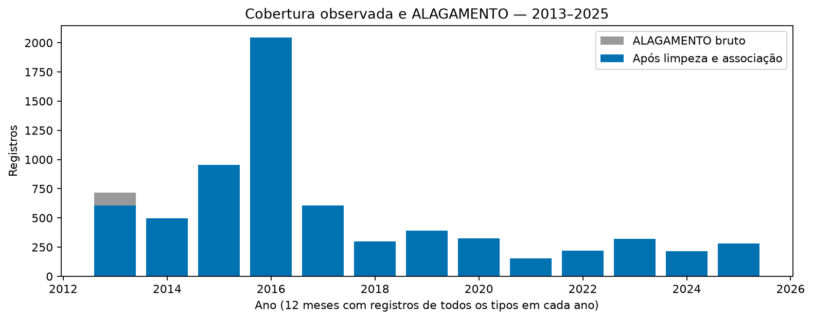
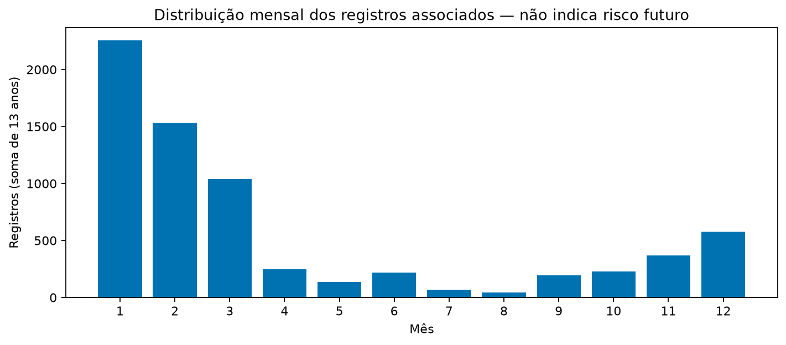
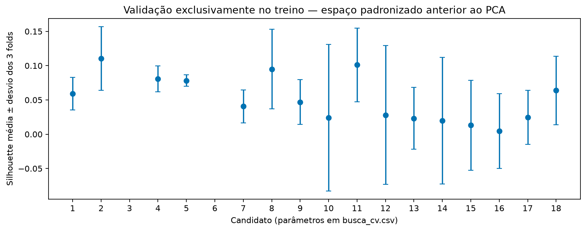
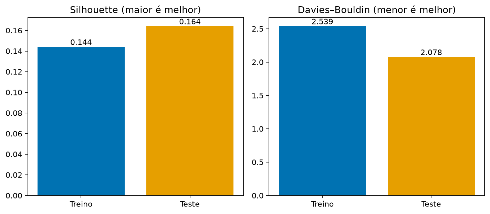
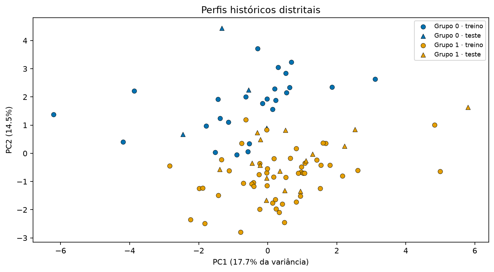
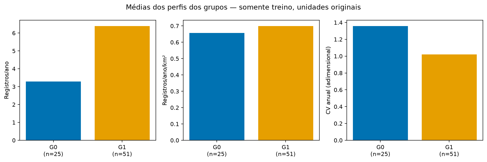
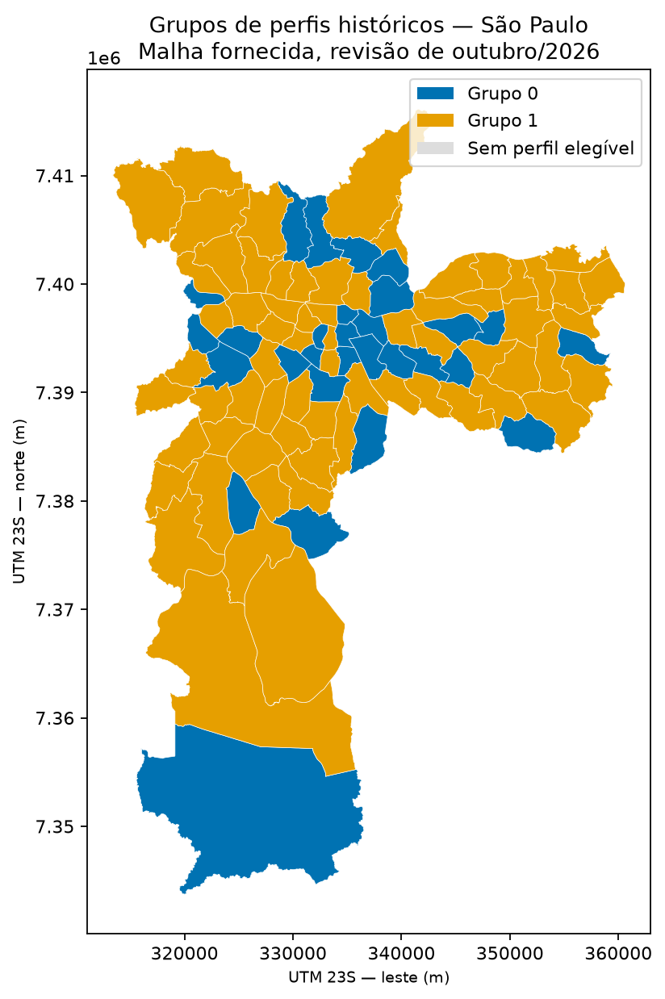

# Resultados executados — Água na Rua

[Voltar ao projeto](../../README.md) · [Relatório](../../RELATORIO_ML.md) · [Requisitos](../../docs/GUIA_AVALIACAO.md) · [Executar no Colab](../../docs/EXECUTAR_COLAB.md)

7032 registros brutos de ALAGAMENTO em 2013–2025; 110 duplicatas removidas; 5 sem associação distrital unívoca; **6917 registros na análise principal**, em 96 distritos.

Após a limpeza, o maior volume anual é 2045 em 2016; janeiro–março concentram 69.8% dos registros. Isso descreve esta base de notificações, sem demonstrar tendência física de alagamentos ou efeito de intervenções.

## Avaliação

Melhor configuração: `n_clusters=2`, `n_init=10`, `pca.n_components=0.9`. Silhouette de validação: **0.1106 ± 0.0464** (3 folds). Dos 18 candidatos, 16 tiveram três folds válidos; candidatos [3, 6] ficaram fora da seleção por terem um fold com somente um grupo previsto (Silhouette indefinida, registrada como N/A).

| Conjunto | n | Grupos | Silhouette | Davies_Bouldin |
| --- | --- | --- | --- | --- |
| treino | 76 | 2 | 0.1442 | 2.5393 |
| teste | 20 | 2 | 0.1642 | 2.0780 |

As Silhouettes observadas (treino 0.1442, validação 0.1106 e teste 0.1642) indicam separação fraca: os perfis se sobrepõem e não sustentam uma tipologia forte. O teste ligeiramente superior ao treino não comprova generalização espacial nem ausência de overfitting.

## Figuras

### 1. Cobertura e registros por ano

Os 13 anos têm registros de algum tipo nos 12 meses. As barras comparam ALAGAMENTO bruto e após limpeza/associação; cobertura observada não comprova registro de todos os eventos.

### 2. Distribuição mensal

Soma de notificações associadas ao longo dos 13 anos; não é previsão ou taxa ajustada por exposição.

### 3. Busca de hiperparâmetros

Silhouette média e desvio-padrão de CV, no espaço padronizado anterior ao PCA. Candidatas com folds incompletos têm N/A e não concorrem; seus detalhes continuam exportados.

### 4. Treino e teste

### 5. Componentes principais

Cores identificam grupos; círculos e triângulos distinguem treino e teste. Os dois primeiros componentes são uma projeção parcial do espaço utilizado pelo modelo.

### 6. Perfis interpretáveis

Médias em unidades originais e tamanhos calculados somente no treino, sem ordenar grupos por perigo.

### 7. Mapa dos grupos

Perfis históricos distritais na malha fornecida. Todos os distritos têm perfil elegível nesta execução; nenhum perfil comprova a condição de uma rua.

## Tabelas e rastreabilidade

| Arquivo | Conteúdo |
| --- | --- |
| [auditoria_arquivos.csv](auditoria_arquivos.csv) | Datas, cobertura, tipos, campos e volume por arquivo anual |
| [tipos_por_arquivo.csv](tipos_por_arquivo.csv) | Contagens de todos os tipos nos 14 anos |
| [cobertura_mensal_todos_tipos.csv](cobertura_mensal_todos_tipos.csv) | Presença de registros por mês, antes do filtro por ALAGAMENTO |
| [manifesto_fontes.json](manifesto_fontes.json) | SHA-256, esquema, CRS, tamanho e origem dos 15 GPKGs |
| [reparos_malha.csv](reparos_malha.csv) | Polígonos inválidos, motivo e área antes/depois do reparo |
| [busca_cv.csv](busca_cv.csv) | Todas as combinações, folds válidos, média, desvio e classificação |
| [metricas_folds.csv](metricas_folds.csv) | Métricas e motivos de N/A nas 54 avaliações |
| [divisao_distritos.csv](divisao_distritos.csv) e [ids_folds.csv](ids_folds.csv) | IDs do treino/teste e da validação exclusivamente no treino |
| [metricas_finais.csv](metricas_finais.csv) e [JSON](metricas_finais.json) | Métricas finais e configuração escolhida |
| [distritos_grupos.csv](distritos_grupos.csv) | Distrito, conjunto, grupo e atributos originais |
| [perfis_grupos_treino.csv](perfis_grupos_treino.csv) | Tamanhos e médias dos perfis somente no treino |
| [Balanço da limpeza](../dados/processados/balanco_limpeza.json) | Entradas, exclusões e registros finais |
| [Modelo e versões](../modelos/metadados.json) | Pipeline avaliado, ajustado somente no treino |

As verificações do repositório ficam em [verificacao_entrega.json](verificacao_entrega.json) e [verificacao_colab.json](verificacao_colab.json). Elas são geradas após a execução dos notebooks, sem alterar o treinamento.
